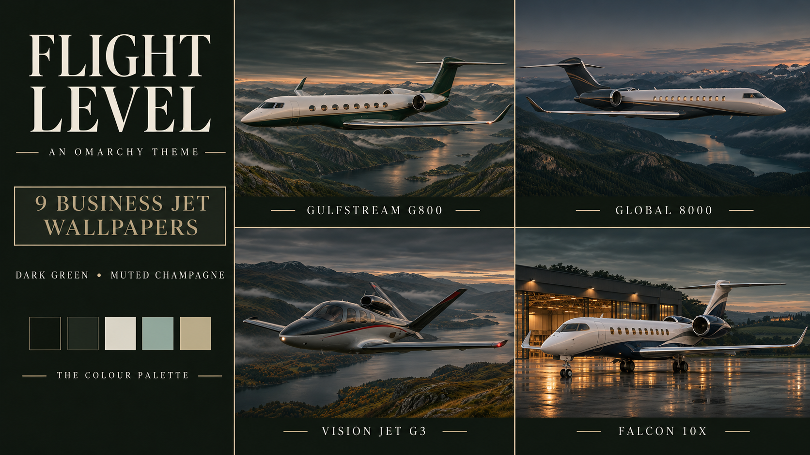

# Flight Level

A dark business aviation theme for Omarchy: green-black surfaces, soft ivory text, smoky sage and muted champagne, with nine cinematic business-jet wallpapers.



*The cover is AI-generated promotional artwork showing four examples and the palette direction. It is not a desktop screenshot.*

## The theme

Mountain fjords, misty lochs, coastal departures and the last light on a wet apron. Seven aircraft are flying, departing or approaching; two are parked. The scenes keep detail in the landscape while leaving the desktop comfortably dark.

Flight Level belongs alongside [Clearance](https://github.com/shaggyrs6-netizen/omarchy-clearance-theme), [Cross Country](https://github.com/shaggyrs6-netizen/omarchy-cross-country-theme) and [Airbridge](https://github.com/shaggyrs6-netizen/omarchy-airbridge-theme), with its own green-black and champagne identity.

The complete named Omarchy palette includes active and inactive window-border colours. Omarchy generates its supported terminal, editor and shell colours from the palette. The package supplies colours and backgrounds; it does not install plugins, change fonts or rearrange the desktop.

| Colour | Value |
|---|---|
| Green-black background | `#131711` |
| Raised olive-grey surface | `#20271f` |
| Soft ivory text | `#dcdad0` |
| Secondary text | `#aaafa4` |
| Muted champagne accent | `#c5bd9f` |
| Smoky sage | `#9eb7af` |
| Selection | `#30372d` |

## Wallpaper collection

The liveries are custom artistic schemes, rather than depictions of named private owners.

| Aircraft and livery | Scene |
|---|---|
| [Gulfstream G800](backgrounds/01-gulfstream-g800-3440x1440.webp) — white, midnight green and champagne | Flying over Norwegian mountain fjords |
| [Bombardier Global 8000](backgrounds/02-global-8000-3440x1440.webp) — silver, charcoal and bronze | Canadian mountain valleys |
| [Dassault Falcon 10X](backgrounds/03-falcon-10x-3440x1440.webp) — white, navy and silver | Parked outside a Bordeaux hangar at twilight |
| [Bombardier Challenger 3500](backgrounds/04-challenger-3500-3440x1440.webp) — ivory, burgundy and platinum | Farnborough terminal after rain |
| [Cirrus Vision Jet G3](backgrounds/05-vision-jet-g3-3440x1440.webp) — graphite, silver and muted red | Scottish loch and misty hills |
| [Embraer Praetor 600](backgrounds/06-praetor-600-3440x1440.webp) — white, dark blue and champagne | Portuguese coastal cliffs |
| [Pilatus PC-24](backgrounds/07-pc24-3440x1440.webp) — white, slate and red | Alpine approach |
| [Cessna Citation Longitude (Model 700)](backgrounds/08-citation-longitude-3440x1440.webp) — white, forest green and silver | Long final in the London area |
| [Embraer Phenom 300E](backgrounds/09-phenom-300e-3440x1440.webp) — silver, charcoal and copper | Caribbean coastal departure after rain |

The Falcon 10X image is developmental-aircraft artwork, not a claim to depict an in-service operator. This collection uses the Vision Jet G3 and the requested Praetor 600.

All nine backgrounds are **3440 × 1440 WebP exports**, upscaled from AI-generated originals **1916–1939 × 811–821** pixels. Export uses Lanczos resampling with a small centred aspect-ratio crop where needed. These are not native 4K or native ultrawide-detail images. Separate 16:9 wallpaper editions are not included; fill/crop display modes on other screen ratios may trim aircraft or scenery.

Airframe shapes, markings, airport geography and lighting are artistic interpretations. These are not photographs, engineering references or operational guidance.

## Installation

Install by repository URL:

```sh
omarchy theme install https://github.com/shaggyrs6-netizen/omarchy-flight-level-theme
```

Select it afterwards if needed:

```sh
omarchy theme set flight-level
```

Choose an aircraft with Omarchy's background picker, or cycle through the collection:

```sh
omarchy theme bg next
```

This is an Omarchy Quattro palette theme. Installing by repository URL does not require a marketplace listing. No registry listing is claimed.

## Validation and limits

The installed Omarchy **4.0.6-1** template renderer was tested against this palette in an isolated output directory. It generated **19 configuration files**, with no unresolved palette tokens. Generated TOML and JSON were parsed. All nine exported backgrounds decode at 3440 × 1440.

The **27 selected text/surface contrast checks** pass a 4.5:1 target; the lowest tested pair is **5.16:1**. These cover selected palette text colours against the background, raised surface and selection colour on opaque surfaces.

The theme has **not been installed or activated on the author's desktop**. The renderer checks do not establish live application behaviour, compatibility with every Omarchy version or whole-desktop accessibility compliance. Transparency, application colour combinations and display calibration can change the result.

## Credits and licence

Theme prepared by Lee Shand / Wired Differently with AI assistance. The nine wallpapers and promotional cover are AI-generated artwork selected for this collection. No aircraft manufacturer or the Omarchy project endorses the theme.

The [MIT licence](LICENSE) covers the supplied theme files, artwork and documentation, to the extent applicable rights exist. It does not promise exclusive copyright in AI-generated imagery or grant rights in third-party trademarks. Aircraft names identify the artistic subjects.
